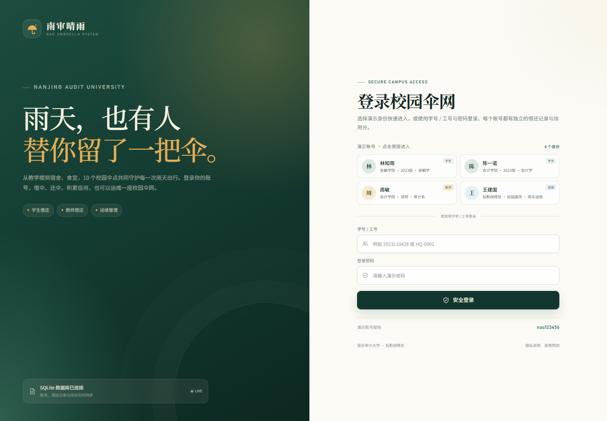
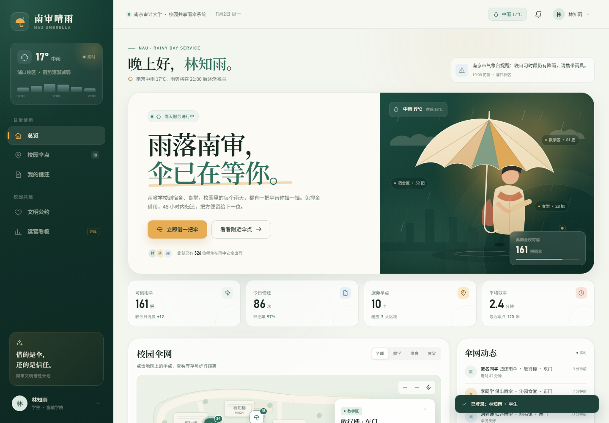

# 南审晴雨 · 南京审计大学校园共享雨伞管理系统

面向南京审计大学浦口校区的校园共享雨伞网站系统。下雨时，老师和学生可以登录自己的账号，在教学区、宿舍区、食堂区的伞点规范借伞、跨点还伞；后勤运维可以查看实时库存、处理告警并补货。所有业务数据写入 SQLite 数据库。





## 技术栈

- 前端：原生 HTML / CSS / JavaScript，无框架、无外部 CDN 依赖
- 后端：Node.js 原生 HTTP 服务
- 数据库：SQLite（Node.js 内置 `node:sqlite`）
- 登录：学号 / 工号 + 密码，Scrypt 密码哈希，数据库会话 + HttpOnly Cookie
- 部署：单进程同时提供静态页面与 JSON API，可配合内网穿透或云服务器访问

## 运行环境

- Node.js **22.5 及以上**（推荐 Node.js 24，需支持 `node:sqlite`）
- 现代浏览器（Chrome / Edge / Firefox）

## 启动

```bash
node server.js
```

默认访问地址：

```text
http://127.0.0.1:8787/
```

首次启动会自动创建 `data/nau.db`，建表并写入演示数据。之后重启服务不会丢失借还记录。

如需修改端口：

```powershell
$env:PORT="8080"
node server.js
```

## 演示账号

所有演示账号密码相同：**`nau123456`**

| 学号 / 工号 | 姓名 | 身份 | 演示重点 |
| --- | --- | --- | --- |
| `2023110428` | 林知雨 | 学生 | 借伞、还伞、信用记录、文明承诺 |
| `2023110516` | 陈一诺 | 学生 | 另一位学生的独立借还记录 |
| `T20180612` | 周敏 | 教师 | 教师账号借还，与学生的数据隔离 |
| `HQ-0091` | 王建国 | 运维 | 运营看板、补货、处理告警、重置演示数据 |

登录页支持点击账号卡片**一键登录**，也可以在下方输入学号 / 工号和密码。

## 不同账号演示脚本

### 场景一：学生借伞，库存真实减少

1. 以 **林知雨 / 学生** 登录。
2. 首页点击「立即借一把伞」，选择「敏行楼 · 东门」，同意文明公约并确认。
3. 进入「我的借还」，可以看到 48 小时倒计时、取伞码和柜格。
4. 此时数据库 `loans` 表新增一条 `active` 记录，伞点库存减少 1。

### 场景二：运维看到学生借伞并补货

1. 点击左下角头像 → 切换为 **王建国 / 运维**。
2. 进入「运营看板」。
3. 「当前在借」变为 1，「今日借出」同步增加。
4. 敏行楼库存显示为 23 / 32。
5. 点击「补货」，库存回到 31 / 32，操作写入 `activities` 表。

### 场景三：教师账号拥有独立记录

1. 切换为 **周敏 / 教师**。
2. 以教师身份借一把伞，再进入「我的借还」。
3. 教师只看到自己的借还记录，学生记录不会混入。
4. 运维看板中的「当前在借」会统计所有账号的在借雨伞。

### 场景四：学生归还，信用分更新

1. 切回学生账号，进入「我的借还」。
2. 点击「立即还伞」，选择归还点。
3. 选择「伞况良好」，确认归还。
4. 借还记录变为已完成，信用分 +1，归还点库存增加。
5. 运维看板的「今日归还」同步增加。

### 场景五：文明公约

进入「文明公约」页面，点击「我承诺文明借还」。签署记录写入数据库，切换账号后每个账号的签署状态独立保存。

## 功能模块

### 雨天总览

- 实时雨情、气象提醒、可借雨伞总数
- 今日借还、服务伞点、平均取伞时间
- 伞网动态：借出、归还、补货记录
- 近七日借还趋势

### 校园伞点

- 教学区、生活区、餐饮区共 10 个伞点
- 自绘校园示意地图，支持区域筛选、地图缩放、点击查看库存
- 实时可借数量、容量、步行距离、开放时间、库存紧张提示
- 地图和卡片均可发起借伞

### 借还闭环

- 借伞：选择伞点 → 确认账号与信用信息 → 同意文明公约 → 生成取伞码
- 还伞：任意伞点归还 → 选择伞况 → 归还成功
- 48 小时内免费，免押金
- 损坏报修会登记待检修数量，并调整信用分
- 一名用户同一时间只允许有一把在借雨伞

### 我的借还

- 当前借用倒计时、取伞码、柜格、到期时间
- 取伞凭证
- 累计借还、按时归还率、信用分
- 该账号的完整借还历史

### 文明公约

- 按时归还、轻拿轻放、主动让伞、及时报修
- 三步借伞指南、雨天问答
- 文明承诺写入 `pledges` 表

### 运营看板

- 今日借出、今日归还、当前在借、待检修
- 近七日借还趋势
- 待处理告警，可逐条处理或全部处理
- 伞点库存表，可补货
- 一键重置演示数据库

## 数据库设计

数据库文件：`data/nau.db`（运行时生成，不提交到 Git）

| 表 | 用途 |
| --- | --- |
| `users` | 账号、角色、学院 / 部门、信用分、密码哈希 |
| `stations` | 伞点位置、区域、库存、容量、开放时间 |
| `loans` | 借还记录，`active` / `returned` |
| `activities` | 全局借还、补货动态 |
| `alerts` | 库存与设备告警 |
| `pledges` | 文明公约签署记录 |
| `daily_stats` | 每日借出 / 归还统计，用于趋势图 |
| `app_settings` | 演示基础数据、平均取伞时间等配置 |
| `sessions` | 登录会话，7 天有效 |

关键约束：

- 每个用户最多一条 `status = 'active'` 的借阅记录（SQLite 部分唯一索引）
- 所有借出、归还、补货操作使用数据库事务
- 密码使用 Scrypt + 随机盐哈希，不以明文存储
- 登录状态通过 HttpOnly Cookie 保存

## API

| 方法 | 路径 | 说明 |
| --- | --- | --- |
| `GET` | `/api/public-config` | 登录页演示账号 |
| `POST` | `/api/login` | 学号 / 工号 + 密码登录 |
| `POST` | `/api/demo-login` | 演示账号一键登录 |
| `POST` | `/api/logout` | 退出登录 |
| `GET` | `/api/bootstrap` | 当前用户、库存、记录、告警、统计 |
| `POST` | `/api/borrow` | 借伞 |
| `POST` | `/api/return` | 还伞 |
| `POST` | `/api/pledge` | 签署文明公约 |
| `POST` | `/api/restock` | 运维补货 |
| `POST` | `/api/alerts/:id/resolve` | 处理单条告警 |
| `POST` | `/api/alerts/resolve-all` | 处理全部告警 |
| `POST` | `/api/admin/reset` | 重置演示数据库（仅运维） |

## 目录结构

```text
.
├── index.html                  # 应用骨架、图标库、登录容器
├── assets
│   ├── css
│   │   └── styles.css          # 设计系统、登录页、业务组件、响应式
│   └── js
│       ├── data.js             # 伞点、账号、雨情、种子数据（前后端共用）
│       └── app.js              # 登录、路由、借还、筛选、后台交互
├── server.js                   # HTTP 服务、SQLite、鉴权、API、静态托管
├── data
│   └── nau.db                  # 运行时数据库（已 gitignore）
├── preview-login.png           # 登录页预览
├── preview.png                 # 学生首页预览
├── .gitignore
└── README.md
```

## 重置演示数据

方式一：以运维账号登录 →「运营看板」→「重置数据」。

方式二：停止服务，删除 `data/nau.db`、`data/nau.db-shm`、`data/nau.db-wal`，再重新启动。

## 说明

本项目是课程作业的可交互系统原型，使用模拟校园数据，不连接真实的校园卡、气象或后勤系统。真实上线需要接入学校统一身份认证、伞柜物联网接口、正式数据库和安全审计。
